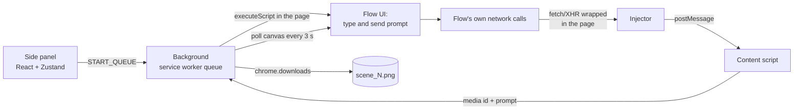

# flow-image-automator

[](https://github.com/JeremyAyza/flow-image-automator/actions/workflows/ci.yml) [](LICENSE)

Experimental Chrome extension that takes a script of image prompts, runs them one scene at a time in Google Labs Flow's web interface and saves each image named after its scene.

> Status: experimental, personal project. It explores how far a Manifest V3 extension can drive a complex single-page app that was never meant to be scripted. I use it with my own Flow account as the image step of my video pipeline. It is not affiliated with Google, uses no Google API, and breaks whenever Flow changes its interface. If you try it, use your own account and check Flow's terms first.

<!-- GIF: side panel loading a script and the queue filling up -->

## Why I built it

Each of my videos needs dozens of scene images. Doing that by hand in Flow means writing every prompt, waiting, downloading and renaming each image. I wanted to see whether an extension could run that loop from a structured script, and it became a hands-on way to learn MV3 internals: main-world scripts, message passing between three contexts, Shadow DOM UIs and DOM automation on an Angular app.

## What it does

- Loads one or several scripts (JSON) from a side panel, validates them with Zod and turns each scene's structured prompt into text.
- Sends up to 3 scenes at a time, waits 30 s between scripts and puts a scene back in the queue if it takes more than 3 minutes.
- Adds the images marked as favorites in Flow as references to every prompt, to keep a consistent style.
- Matches each generated image to its scene and downloads it as `Flow_Generations/<script>_<timestamp>/scene_N.png` (`thumbnail.png` for scene 0).
- When Flow shows its "too quickly" message, stops for 60 s and then retries the affected scenes.
- When a run finishes, removes the generated images from the Flow canvas (they are already on disk).

## How to run it

Requirements: Node.js 22 (see `.nvmrc`), Google Chrome and a Google account with access to Flow.

```bash
git clone https://github.com/JeremyAyza/flow-image-automator
cd flow-image-automator
npm ci
npm run build
```

1. Open `chrome://extensions`, turn on Developer mode and choose **Load unpacked** → `.output/chrome-mv3`.
2. Open Flow and sign in. The side panel appears on the left.
3. Paste or upload a script (see `examples/script.example.json`), give it a name and press Start. Images are saved in Chrome's download folder.

<details>
<summary>Script format</summary>

```json
{
  "thumbnail_prompt": { "subjects": [{ "description": "...", "action": "..." }], "environment": "...", "lighting": "...", "composition": "...", "style": "..." },
  "scenes": [
    { "scene_number": 1, "image_prompt": { "subjects": [{ "description": "...", "action": "..." }], "environment": "...", "lighting": "...", "composition": "...", "style": "..." } }
  ]
}
```

For several scripts at once, use an object keyed by script name: `{ "video-1": { ... }, "video-2": { ... } }`.
</details>

## How it works



Each scene goes through four UI steps in the page (scroll, add favorite references, type the prompt, send), spaced by random 1–4 s pauses. The background then polls the canvas every 3 seconds for new images.

```text
entrypoints/
├── background.ts        # Queue orchestrator and message router
├── injector.ts          # Runs in the page: wraps fetch/XHR to read Flow's responses
├── content.ts           # Forwards those responses to the background
└── sidebar.content/     # Side panel (Shadow DOM): load scripts, queue, countdowns, debug buttons
src/
├── automation/          # Prompt injection, canvas polling, DOM helpers for Flow
├── media/               # Match responses to scenes, download, clean up the canvas
├── queue/               # Queue state and limits
└── shared/              # Script schema (Zod) and prompt builder
test/                    # Vitest with WXT's fake browser
```

## Technical decisions

- **Read Flow's own network responses instead of only scraping the page.** A script in the page's main world wraps `fetch` and `XMLHttpRequest` to read the media id and prompt of each batch, so every image is matched to its scene even with three in flight. Trade-off: it depends on undocumented internal responses; if they change, a fallback assigns new images to the scene in progress.
- **Automate the web interface, not an API.** That is the experiment itself: driving a real Angular app from outside through its DOM. The price is fragility: it needs a signed-in browser, it is slower than an API, and any UI change can break a step.
- **A small hand-written queue in the service worker.** Each scene has a status (pending, in progress, rate limited, downloaded, error) and the limits follow what the page shows: 3 in flight, a 60 s stop on "too quickly", a 3-minute timeout. Trade-off: the queue lives in memory and is lost if the extension reloads.
- **Selectors based on Flow's components and data attributes** (`flow-grid-tile-container`, `data-media-id`, `data-tile-id`) with fallbacks, never Angular's generated attributes. A debug panel runs each step on its own (find the editor, the send button, favorites, delete) to see which one broke after a UI change.

## Tests

```bash
npm test            # Vitest
npm run typecheck   # tsc --noEmit
```

They cover the script schema and prompt builder, the queue's state changes (rate limit, retry, 3-minute timeout), and how batch responses and new images are matched to scenes and named on download. The browser APIs are faked; nothing here talks to Flow. CI runs typecheck, tests and the production build.

## Known limitations

- Built and used on Chrome only.
- Menu labels are matched in Spanish and English.
- Two fixed instructions are appended to every prompt (keep the reference style, write any on-image text in Spanish); they suit my own videos and are hardcoded.
- One image per scene.
- The DOM automation itself has no automated tests; it is checked by hand with the debug panel.

## License

[MIT](LICENSE)

## Author

Jeremy Ayza · [GitHub](https://github.com/JeremyAyza) · [LinkedIn](https://linkedin.com/in/JeremyAyza)
